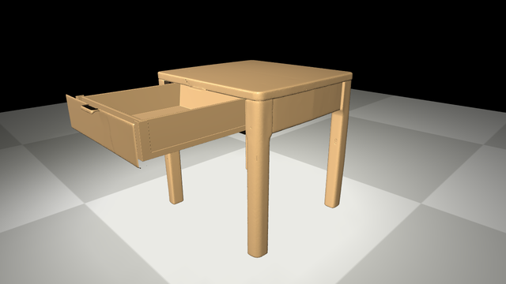
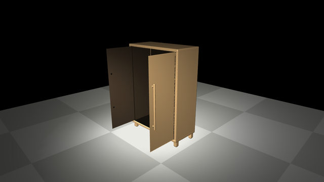
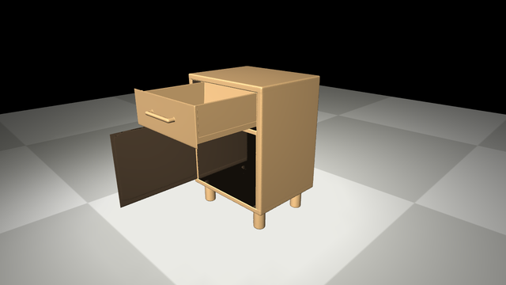
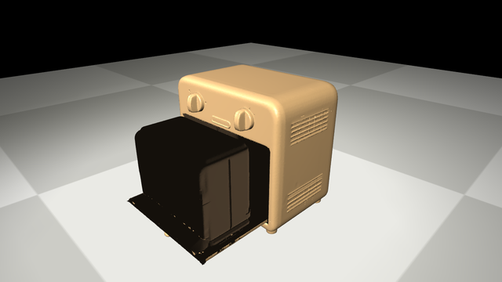
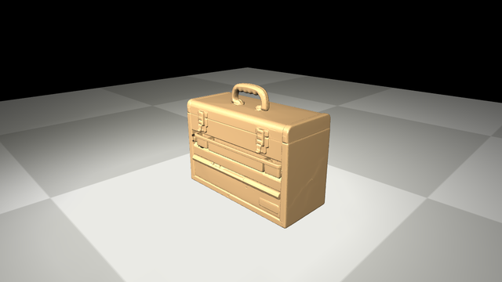
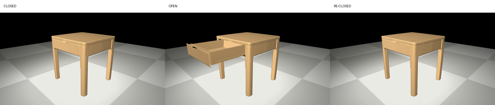
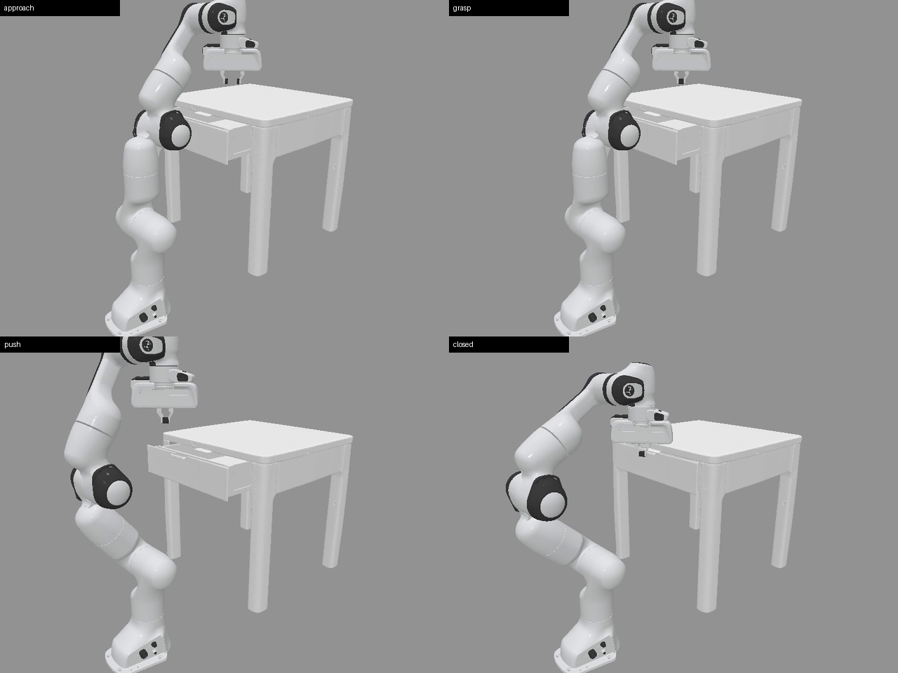

# ArticForge：一句话生成可训练关节物体资产

> **一句话 → 可训练关节物体资产**：约 10 分钟、41 积分（约 ¥4），产出带物理碰撞与逐关节力标定的 URDF，可在 MuJoCo / ManiSkill 中直接仿真与操作。

| 边桌 side-table-01 | 衣柜 wardrobe-01 | 床头柜 nightstand-02 |
|---|---|---|
|  |  |  |

| 迷你烤箱 oven-mini-01 | 工具箱 toolbox-01 |
|---|---|
|  |  |

*5 件由一句话生成的资产，均带真实开合关节（图为最新渲染的打开状态）*

---

## 一、为什么需要它

具身智能的操作学习需要大量**带运动学和动力学真值的关节物体**——能开门、能拉抽屉，质量、摩擦、限位都要对。

| 现有来源 | 局限 |
|---|---|
| 手工资产（PartNet-Mobility 等） | 标注贵、品类少、无法按需扩展 |
| LLM 规则生成 | 几何粗糙、没有物理参数、无法仿真 |

ArticForge 把群核 LUX3D 的一句话文生 3D 能力，自动加工成「物理正确、可仿真、可训练」的资产：成本压到一杯奶茶钱、十分钟一件，并可按需定制（"左开门的薄荷绿烤箱"）。**不是做一个资产，而是做生产资产的平台。**

## 二、产品做了什么

```
一句话文本
  → ① 文生 3D + 关节化（云端 LUX3D）
  → ② 自动适配 / 凸包碰撞 / 逐关节力标定（本地 MuJoCo）
  → ③ 跨引擎验证与 Panda 机械臂操作（ManiSkill3 / SAPIEN）
  → 自包含 URDF 资产（网格 + 碰撞 + 标定 + 场景 + 视频）
```

- **云端**：文生 3D、上传、关节化，直接交付 URDF 包
- **本地**：坐标系/惯量适配、CoACD 凸包碰撞、扫掠过滤、力探针标定，全部自动推导
- **跨引擎**：在 SAPIEN/Physx 中验证力学一致性，并用 Panda 完成拉开与推关

每件交付约 30 个文件：URDF、十余个凸包碰撞 STL、力标定 JSON+曲线、双 MJCF 场景、物理/演示双视频、三态快照（关/开/回关）。

## 三、做出了什么效果

| 指标 | 结果 |
|---|---|
| 资产交付 | 5 件，每件 41 积分（约 ¥4）/ 约 10 分钟 |
| 离线回归 | 16/16 PASS |
| 跨引擎冒烟 | 22/22 PASS（MuJoCo 标定的力在 Physx 同样有效） |
| 机械臂操作 | Panda 形闭合抓取，抽屉拉开 70% 行程，`grasp_valid=True` |
| 推关任务 | 第 10 步 `CloseAholoDrawer-v0`，2 件资产 SUCCESS，0 积分 |



*抽屉：关闭 → 拉开 → 回关（MuJoCo 演示；物理驱动版本见下方视频）*



*Panda 在 ManiSkill 中接近、抓取并推关抽屉（来自最新离屏渲染）*

[▶ 推关演示视频](docs/report-assets/panda-close-drawer-offscreen.mp4) · [物理驱动视频](assets/side-table-01/side-table-01_physics.mp4)

每件资产自带的逐关节力标定：抽屉启动力 1.35N、全程 33.3cm、行程 100%（数据见 `assets/<资产名>/force_probe_report.json`）。

## 四、意义与创新

1. **门槛降到一杯奶茶钱**：一句话 → 可训练资产，约 10 分钟交付，按需求无限定制。
2. **独有的力标定元数据**：每件资产带逐关节启动力 / 行程 / 质检结果——PartNet-Mobility 等手工资产没有，可直接用于难度分层、reward shaping、sim2real 参考。
3. **质量可验证**：像素级程序化验收 + 跨引擎力学一致性，不靠肉眼判图。
4. **可复制、不退化**：流水线参数化 + 离线回归，换一句提示词就是新品类，且不破坏已有资产。
5. **诚实的边界**：门族推关触及运动学边界，留给下一阶段学习方法；抽屉推关已由第 10 步覆盖。

## 五、复现

```bash
source scripts/maniskill-env.sh
# 离线回归（0 积分）
.venv/bin/python pipeline/test_factory.py
# 交互查看器
.venv/bin/python pipeline/8_render_video.py --asset side-table-01 --view
# Panda 推关（含离屏视频）
.venv-maniskill/bin/python pipeline/10_close_drawer.py --asset side-table-01 \
    --record-every 1 --record docs/report-assets/panda-close-drawer-offscreen.mp4
```

- **技术要点**：[README.md](README.md) 的「已知陷阱」小节（8 条踩坑结论）
- **任务环境**：`OpenAholoDrawer-v0`（拉开）、`CloseAholoDrawer-v0`（推关）
- **资产明细**：`assets/<资产名>/`（URDF、碰撞体、标定、视频、快照）· 提交记录：`output/records/`
